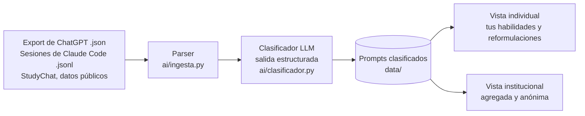

# TanIA

**Haz más con IA, sin dejar de aprender.**

> Mostramos a estudiantes, universidades y profesionales qué habilidades dejan de practicar al usar IA, analizando sus prompts y enseñándoles a reformularlos para aprender mientras producen.

🔗 **Demo:** _[URL pública — pendiente]_ · 🎥 **Video de respaldo:** _[link — pendiente]_

---

## 1. Founder

<!-- foto: docs/founder.jpg -->

**Brisa Cruz** — socióloga por la PUCP y asistente de investigación en GRADE, alumna de la Diplomatura en Ciencia de Datos para las Ciencias Sociales y la Gestión Pública (Q-Lab PUCP).

No soy ingeniera de software, soy científica social: estudio comportamiento y soy la usuaria que tiene el problema. Vengo de R y aprendo Python con Claude Code. Cada semana me pregunto qué parte de lo que "hice" aprendí de verdad.

Además de investigadora, soy escritora en mis tiempos libres. Me encanta redactar, imaginar y diseñar. Amo aprender y crear y, sobre todo, amo cómo pienso. Mi mayor temor es que mi necesidad de productividad me haga perder eso que más amo.

**Cómo cubro cada rol con agentes de IA:**

| Rol | Cómo lo cubro |
| --- | --- |
| Producto | Revisión de literatura y tipología de queries, con Claude como asistente de investigación |
| Ingeniería | Claude Code como co-founder técnico; yo reviso y entiendo cada archivo |
| Diseño | Dashboard en Streamlit con estilo propio, iterado con el agente |
| Ventas | Benchmark de precios y mercado; conversaciones con usuarios potenciales |

## 2. Problema

**Quién lo sufre:** estudiantes de pregrado y posgrado, y profesionales que aprenden a programar por su cuenta, que usan ChatGPT o Claude a diario para sus tareas de código. Del otro lado están las universidades y diplomaturas que los forman.

**Cuánto les cuesta:** la IA sube el rendimiento en la tarea, pero no el aprendizaje.

- En un ensayo aleatorizado, quienes aprendieron una librería de Python con IA sacaron **50 % en la evaluación, frente a 67 %** de quienes programaron a mano. La mayor brecha estuvo en **depuración** (Shen y Tamkin, Anthropic, 2026).
- En un curso introductorio de la TUM (N = 275), ChatGPT subió la nota del ejercicio, pero **no mejoró la ganancia de conocimiento** (Bassner et al., 2025).
- Quienes usaron IA sin restricciones fracasaron **77 %** de las veces al mantener su código sin IA (Sankaranarayanan, 2026).
- El daño depende de **cómo** se pregunta: dentro del mismo grupo con IA, quienes delegaban sacaron entre 24 % y 39 %, y quienes preguntaban para entender, entre 65 % y 86 % (Shen y Tamkin, 2026).

**Cómo lo resuelven hoy:** no lo resuelven. Las universidades prohíben, detectan texto generado con IA (Turnitin) o confían en la buena voluntad. Los "modos de estudio" de ChatGPT y Claude cambian cómo responde la IA, pero nadie le muestra a la persona **su propio patrón** a lo largo del tiempo.

**Evidencia de usuarios:** notas de 3 conversaciones en [`docs/research/`](docs/research/). _[pendiente]_

## 3. Solución e insight

TanIA lee tu historial de prompts (el export de ChatGPT o las sesiones de Claude Code), clasifica cada uno según **cómo estás usando la IA** y te muestra:

1. **Qué habilidades estás dejando de ejercitar:** descomponer problemas, leer errores, depurar, diseñar.
2. **Qué podrías haber hecho por tu cuenta.**
3. **Cómo reformular tus prompts** para seguir aprendiendo mientras produces.

| Lo que sueles pedir | Lo que TanIA te sugiere |
| --- | --- |
| "No funciona, arréglalo" + traceback | "¿Qué significa este error y en qué línea buscarías? No me des el arreglo todavía." |
| "Hazme una función que limpie esta base" | "¿En qué pasos dividirías esta limpieza? Dame solo el primero y yo intento el código." |

**Insight:** el problema no es *cuánto* usas la IA, sino *cómo* le preguntas. La forma de delegar se lee en el texto del prompt, y los modos de interacción que preservan el aprendizaje ya están identificados en la literatura. TanIA convierte esa evidencia en un espejo personal.

Revisión de literatura completa: [`docs/research/revision-literatura.md`](docs/research/revision-literatura.md).

## 4. Why now

- **La evidencia es de 2024 a 2026.** Hasta hace poco no había ensayos aleatorizados que distinguieran qué formas de usar la IA dañan el aprendizaje y cuáles no.
- **Clasificar texto con LLMs es casi gratis.** Clasificar y reformular un prompt cuesta menos de US$ 0.0002 con un modelo pequeño. Hace tres años, esto habría requerido etiquetadores humanos.
- **Los historiales ya son exportables.** ChatGPT permite descargar tus conversaciones y Claude Code guarda cada sesión en tu computadora.
- **La IA ya está en todas las aulas.** Las universidades necesitan algo distinto -o más refinado- que prohibir o detectar.

## 5. Demo

**Cómo correrlo en local:**

```bash
git clone https://github.com/brisacruz22/tanIA.git
cd tanIA
uv sync                      # o: pip install -r requirements.txt
cp .env.example .env         # agrega tu ANTHROPIC_API_KEY
uv run streamlit run app/streamlit_app.py
```

**Flujo principal (capturas en `docs/`):** _[pendientes]_

1. Subes tu historial (o usas el de ejemplo).
2. TanIA clasifica cada prompt y muestra tu mapa de habilidades.
3. Ves tus prompts más frecuentes junto con su versión reformulada.

**Arquitectura:**



**Modelos y por qué:**

- **Claude Haiku 5.5** (API de Anthropic) para clasificar y reformular. Es barato (US$ 0.10 por millón de tokens de entrada), rápido y devuelve JSON validado con un esquema Pydantic.
- **Streamlit**, desplegado en Streamlit Community Cloud: gratis y en Python.
- **Datos del demo:** mi propio historial del curso y [StudyChat](https://consensus.app/papers/details/2df19ae512c55ea7b631ebb02138e567/) (UMass), un dataset público de conversaciones de estudiantes con un tutor LLM. No se usan datos personales de terceros. # esto va a cambiar, quiero usar mi gpt también

## 6. Modelo de negocio

| Plan | Para quién | Precio |
| --- | --- | --- |
| Gratis | Individuos | Hasta 200 prompts analizados al mes |
| Pro | Individuos | US$ 4 al mes (≈ S/ 15) |
| Institucional | Universidades y diplomaturas | US$ 3 por estudiante al año, en el rango de Turnitin (US$ 1.79 a 6.50) |

**Costo por usuario:** cada prompt usa ~800 tokens de entrada y ~150 de salida. Un estudiante típico (100 prompts al mes) cuesta **US$ 0.016 al mes** en tokens. El servidor es gratis hasta escalar.

**Margen de contribución:** más de 90 % en el plan institucional (US$ 3 frente a ~US$ 0.12 por estudiante al año).

### Escalabilidad

- **Dominios:** empezamos por programación porque ahí el daño está medido y el usuario es claro. El motor (clasificar el modo de delegación y reformular) es el mismo para **escritura y argumentación** y para **razonamiento matemático**: solo cambia la tipología de habilidades.
- **Empresas:** venta a áreas de capacitación (L&D). El trabajador es el usuario y la empresa es el cliente que paga por saber **qué capacitar, nunca a quién vigilar**:
  - El diagnóstico individual solo lo ve la persona.
  - La empresa ve agregados por equipo, con un mínimo de 8 personas por grupo y sin rankings.
  - La participación es voluntaria y revocable, y se prohíbe por contrato usar los datos en evaluaciones de desempeño.
- **Mercado:** _[TAM, SAM y SOM — ver benchmark]_

## 7. Herramientas del curso

| Herramienta | Sesión | Dónde está | Por qué |
| --- | --- | --- | --- |
| LLMs con salidas estructuradas | 08 | `ai/clasificador.py` | Cada prompt necesita una etiqueta confiable (modo, habilidad, reformulación) que se pueda agregar y graficar |
| Dashboards | 05 | `app/streamlit_app.py` | El diagnóstico tiene que entenderse de un vistazo |
| _[opcional] Skill de Claude Code_ | 16 | `ai/skill/` | Versión en vivo: feedback mientras programas |

## 8. Qué hizo el agente

_[Completar con honestidad al final: qué archivos generó Claude Code, qué revisé y cambié yo, qué partes escribí a mano.]_

- Investigación: Claude me ayudó con la revisión de literatura y el benchmark de mercado; yo definí las preguntas y validé las fuentes.
- Código: _[pendiente]_

---

Licencia: MIT · Proyecto final de Python Intermedio, Diplomatura Q-Lab PUCP 2026
