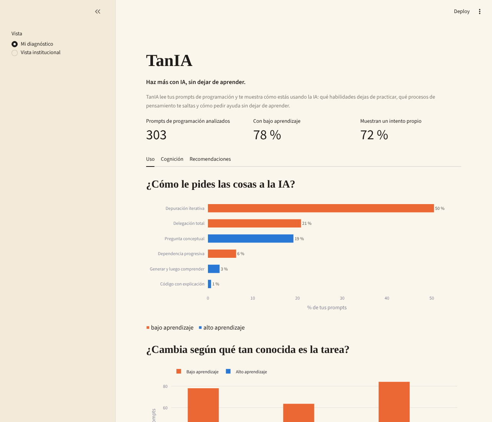
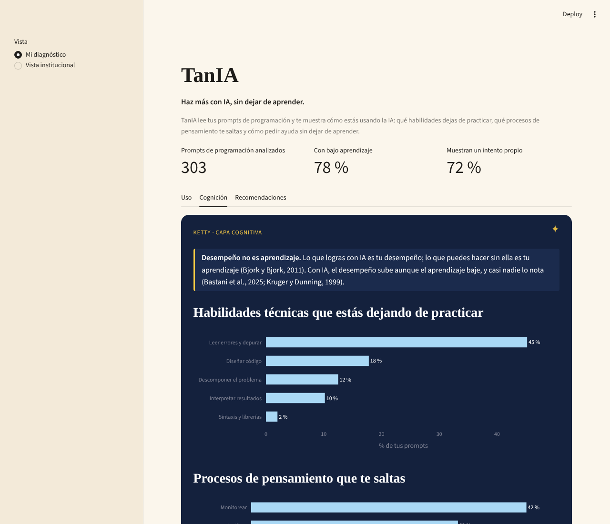
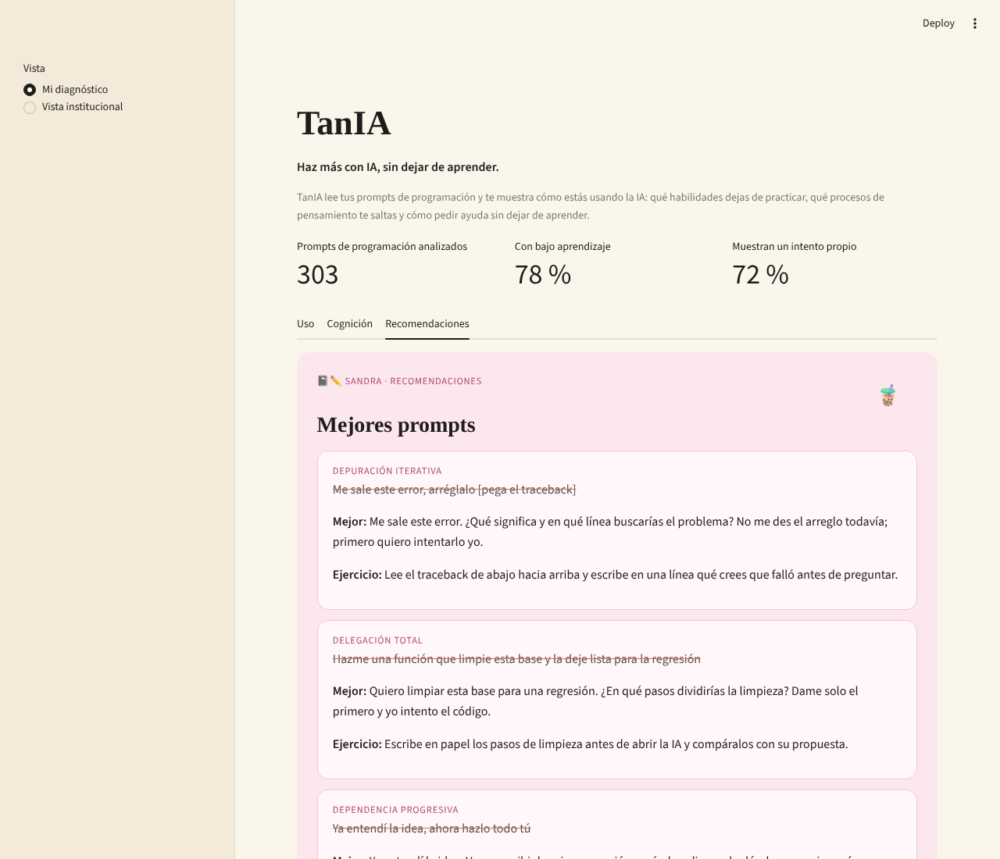
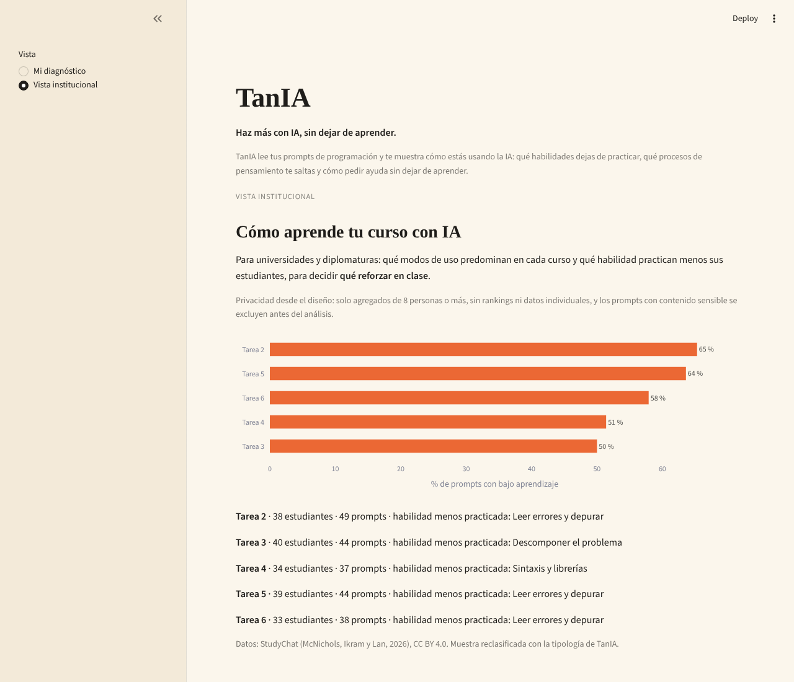
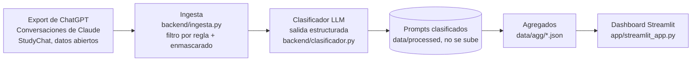

# TanIA

**Haz más con IA, sin dejar de aprender.**

> Mostramos a estudiantes, universidades y profesionales qué habilidades dejan de practicar al usar IA, analizando sus prompts y enseñándoles a reformularlos para aprender mientras producen.

🔗 **Demo:** [tania-demo.streamlit.app](https://tania-demo.streamlit.app/)

---

## 1. Founder

**Brisa Cruz**: socióloga por la PUCP y asistente de investigación en GRADE, alumna de la Diplomatura en Ciencia de Datos para las Ciencias Sociales y la Gestión Pública (Q-Lab PUCP).

No soy ingeniera de software, soy científica social: estudio comportamiento y soy la usuaria que tiene el problema. Vengo de R y aprendo Python con Claude Code. Cada semana me pregunto qué parte de lo que "hice" aprendí de verdad.

Además de investigadora, soy escritora en mis tiempos libres. Me encanta redactar, imaginar y diseñar. Amo aprender y crear y, sobre todo, amo cómo pienso. Mi mayor temor es que mi necesidad de productividad me haga perder eso que más amo.

**Cómo cubro cada rol con agentes de IA:**

| Rol | Cómo lo cubro |
| --- | --- |
| Producto | Revisión de literatura, tipología y 4 entrevistas a usuarios; Claude como asistente de investigación |
| Ingeniería | Claude escribió el código a partir de mis decisiones; yo reviso y entiendo cada archivo |
| Diseño | Dashboard en Streamlit con estética propia por pestaña, iterado con el agente |
| Ventas | Benchmark de precios y mercado; disposición a pagar validada en entrevistas |

## 2. Problema

**Quién lo sufre:** estudiantes y profesionales que programan con ChatGPT o Claude a diario, sobre todo quienes **ya sabían programar y lo están dejando de hacer**. Del otro lado están las universidades y diplomaturas que los forman, que hoy no saben cómo afecta la IA el aprendizaje de sus estudiantes.

**Cuánto les cuesta:** la IA sube el desempeño en la tarea, pero no el aprendizaje, y quien la usa no lo nota.

- En un ensayo aleatorizado, quienes aprendieron una librería de Python con IA sacaron **17 % menos** en la evaluación posterior (50 % frente a 67 %), sin ganar velocidad de forma significativa. La mayor brecha estuvo en **depuración** (Shen y Tamkin, 2026).
- Quienes usaron IA sin restricciones fracasaron **77 %** de las veces al mantener su propio código sin IA, frente a 39 % cuando tuvieron que explicar el código antes de aceptarlo (Sankaranarayanan, 2026).
- En un experimento con ~1,000 estudiantes, ChatGPT sin guardrails subió las notas de práctica 48 %, pero bajó **17 %** las del examen sin IA. Los estudiantes no percibieron que habían aprendido menos (Bastani et al., 2025).
- El daño depende de **cómo** se pregunta: dentro del mismo grupo con IA, quienes delegaban sacaron entre **24 % y 39 %**, y quienes preguntaban para entender, entre **65 % y 86 %** (Shen y Tamkin, 2026).

**Lo que dicen los usuarios** (4 entrevistas, [`docs/research/`](docs/research/)):

> "Mi capacidad intelectual alrededor del código ha empeorado, mi materia gris está en descanso." (Sofía, analista de datos)

> "En teoría yo había creado esto pero no sabía lo que hacía mi repo." (Sofía)

> "Se siente como estar exponiendo algo que tú has hecho del 30 % y otra persona lo hizo del 70 %, y si te hacen una pregunta, you're dead." (Mariana, asistente de investigación)

> "Tú no puedes evitar que la gente use IA. No lo vas a hacer nunca." (Tiago, investigador)

Y no es solo una decisión individual: los plazos se acortaron desde que la IA es común. "Me dieron cuatro días para limpiar la base de datos de cuatro países" (Mariana). "Por métricas de productividad, si me pusiera a hacer las cosas a mano, no me contratarían" (Sofía).

**Cómo lo resuelven hoy:** no lo resuelven. Las universidades prohíben, detectan texto generado con IA o confían en la buena voluntad. Algunos usuarios se arman su propio método (bitácoras, spec-driven development, leer todo el código antes de correrlo), pero cuesta tiempo que casi nadie tiene.

## 3. Solución e insight

TanIA lee tu historial de prompts (el export de ChatGPT o tus conversaciones de Claude), clasifica cada uno según **cómo estás usando la IA** y te lo muestra en tres capas:

1. **Uso:** cómo le pides las cosas a la IA (seis modos de interacción) y si la tratas como consultora o como contratista.
2. **Cognición:** qué habilidades técnicas dejas de practicar (leer errores, descomponer, diseñar) y qué procesos metacognitivos te saltas (planificar, monitorear, evaluar). Parte de una distinción clásica: **desempeño no es aprendizaje** (Bjork y Bjork, 2011).
3. **Recomendaciones:** cómo reformular tus prompts, un plan de repaso espaciado, el ejercicio "explícalo con tus palabras" y una **mini prueba sin IA** que compara cuánto crees que sabes con cuánto sabes.

| Lo que sueles pedir | Lo que TanIA te sugiere |
| --- | --- |
| "No funciona, arréglalo" + el error | "¿Qué significa este error y en qué línea buscarías? No me des el arreglo todavía." |
| "Hazme una función que limpie esta base" | "¿En qué pasos dividirías esta limpieza? Dame solo el primero y yo intento el código." |

**Insight:** el problema no es *cuánto* usas la IA, sino *cómo* le preguntas, y esa forma se lee en el texto del prompt. Los modos que preservan el aprendizaje ya están identificados en la literatura; TanIA convierte esa evidencia en un espejo personal y en un plan. Los entrevistados lo confirmaron: el diagnóstico importa porque el daño es invisible, pero lo que más piden es **qué hacer después**.

**Lo que encontré en mis propios datos** (303 prompts de programación de mi tesis, la diplomatura y un proyecto de NLP):

- **78 %** de mis prompts caen en modos de bajo aprendizaje. El más frecuente es la depuración iterativa (50 %): pego el error y pido el arreglo. Por eso la habilidad que más dejo de practicar es **leer errores y depurar** (45 %), justo donde Shen y Tamkin encontraron la mayor brecha.
- **Consultar o encargar lo cambia todo.** El 71 % de mis prompts son órdenes (postura de contratista) y casi todos (95 %) son de bajo aprendizaje. Cuando pregunto como consultora, el 65 % es de alto aprendizaje. Es el mismo patrón que describe Sankaranarayanan (2026).
- **La familiaridad importa, pero no como esperaba.** Aprendo más en el curso, donde estoy aprendiendo a propósito (36 % de alto aprendizaje), que en mi tesis, que domino (22 %), y mucho menos en el proyecto nuevo (16 %). Justo cuando la tarea es nueva, que es cuando más necesitaría aprender, más delego. Ojo: el curso y el proyecto nuevo tienen pocos prompts.
- En 72 % de mis prompts muestro un intento propio, pero el cierre se lo dejo a la IA: el proceso que más me salto es **monitorear** (42 %).

Revisión de literatura completa: [`docs/research/revision-literatura.md`](docs/research/revision-literatura.md).

## 4. Why now

- **El mayor proveedor acaba de validar el problema.** En julio de 2026, Anthropic lanzó en Claude una función de reflexión que muestra tus patrones de uso según un marco de fluidez con IA ([Infobae](https://www.infobae.com/america/agencias/2026/07/10/anthropic-lanza-en-claude-una-herramienta-para-que-el-usuario-visualice-y-revise-como-usa-la-ia/)). TanIA va un paso más allá: no mide qué tan bien usas la IA, sino **qué dejas de aprender** al usarla, con evidencia experimental, en ChatGPT y Claude a la vez, y con una vista para instituciones.
- **La evidencia es de 2024 a 2026.** Hasta hace poco no había experimentos que distinguieran qué formas de usar la IA dañan el aprendizaje y cuáles no.
- **Clasificar texto con LLMs es casi gratis.** Clasificar y reformular un prompt cuesta menos de US$ 0.0002 con un modelo pequeño.
- **Los historiales ya son exportables.** ChatGPT permite descargar tus conversaciones y Claude guarda tus proyectos.
- **La presión por productividad es estructural.** Las instituciones no pueden prohibir la IA; necesitan saber cómo afecta a su gente.

## 5. Demo

**Demo en vivo:** [tania-demo.streamlit.app](https://tania-demo.streamlit.app/)

**Flujo principal:**

1. **Uso:** tus modos de interacción, cómo cambian según la familiaridad con la tarea y si consultas o encargas.
2. **Cognición:** habilidades y procesos que te saltas, con "Entender mejor" para profundizar.
3. **Recomendaciones:** reformulaciones, plan de repaso, mini prueba sin IA y una caja para analizar un prompt tuyo en vivo (no se guarda).
4. **Vista docente:** resultados agregados por grupo, nunca individuales, con un mínimo de 8 personas por grupo.

| Uso | Cognición |
| --- | --- |
|  |  |
| **Recomendaciones** | **Vista institucional** |
|  |  |

**Arquitectura:**



**Cómo funciona por dentro:**

- **Ingesta** (`backend/ingesta.py`): junta los historiales, enmascara correos, claves y rutas, y filtra con expresiones regulares los prompts que parecen de programación (445 de 1,587).
- **Clasificador** (`backend/clasificador.py`): un clasificador zero-shot con **Claude Haiku 5.5** que devuelve un JSON validado con un esquema **Pydantic**: modo, habilidad, proceso cognitivo, postura, reformulación y ejercicio. Funciona como un segundo filtro: de 445 prompts, 303 resultaron ser de programación. Guarda línea por línea y retoma donde se quedó.
- **Agregados:** el repo y el dashboard solo contienen porcentajes. Ningún prompt real se publica.
- **Vista institucional** (`backend/studychat.py`): clasifica una muestra de StudyChat con la misma tipología y oculta los grupos de menos de 8 personas.

**Cómo correrlo en local:**

```bash
git clone https://github.com/brisacruz22/tanIA.git
cd tanIA
uv sync                      # o: pip install -r requirements.txt
cp .env.example .env         # agrega tu ANTHROPIC_API_KEY
uv run python backend/clasificador.py           # clasifica tus prompts
uv run python backend/clasificador.py --resumen # genera los agregados
uv run streamlit run app/streamlit_app.py
```

## 6. Modelo de negocio

El negocio principal es **institucional**: las universidades ya están preocupadas y pagan por herramientas de integridad académica. Los individuos son la puerta de entrada y la fuente de evidencia.

| Plan | Para quién | Precio |
| --- | --- | --- |
| Prueba | Individuos | Gratis, hasta 200 prompts |
| Pro Programación | Individuos | US$ 4 al mes |
| Pro Completo | Individuos | US$ 8 al mes: programación y escritura, con plan de aprendizaje y recordatorios |
| Institucional | Universidades y diplomaturas | US$ 3 a 4 por estudiante al año según funciones, en el rango de Turnitin (US$ 1.79 a 6.50) |

**Validación en entrevistas:**

- "Si yo pago 20 dólares por Claude, pagaría 5 dólares por algo que me desclaude el cerebro" (Sofía); hasta 8.
- Tiago pagaría más de 10 dólares si incluye un plan de aprendizaje con recordatorios, después de una prueba gratuita.
- Mariana pagaría por el módulo de escritura lo que paga por su suscripción de música.
- Sobre instituciones: la universidad "está hiper preocupada" y "sí te pagaría" (Sofía). Organismos con misión de desarrollo y universidades grandes de investigación también (Mariana).

**Costo por usuario:** cada prompt usa ~800 tokens de entrada y ~150 de salida. Un estudiante típico (100 prompts al mes) cuesta **US$ 0.016 al mes** en tokens. **Costo de servidor:** el piloto corre gratis en Streamlit Community Cloud. Al escalar, un servidor pequeño en la nube cuesta del orden de US$ 20 a 50 al mes, lo que con 1,000 estudiantes institucionales suma menos de US$ 0.05 por estudiante al mes. Margen de contribución de más de 90 % en el plan institucional.

**Vista institucional, con privacidad desde el diseño:**

- El diagnóstico individual solo lo ve la persona.
- La institución ve agregados por curso o grupo, con un mínimo de 8 personas y sin rankings.
- Los prompts con contenido sensible se excluyen de la vista institucional.
- La participación es voluntaria y revocable, y se prohíbe por contrato usar los datos para evaluar a las personas.

### Escalabilidad

- **Dominios:** empezamos por programación porque ahí el daño está medido. El motor es el mismo para **escritura y argumentación**, el dominio que más preocupa a los entrevistados ("aprender a razonar es aprender a escribir", Sofía).
- **Integración:** un skill de Claude Code o una extensión de navegador que dé feedback mientras trabajas, como el aviso de tokens.
- **Funciones:** recordatorios ("hoy preguntaste cuatro veces esto"), comparación del antes y el después de tus prompts, y una "puerta de explicación" opcional antes de aceptar código.
- **Empresas:** áreas de capacitación que quieren saber **qué capacitar, nunca a quién vigilar**, con las mismas reglas de privacidad.


## 7. Herramientas del curso

| Herramienta | Sesión | Dónde está | Por qué |
| --- | --- | --- | --- |
| LLMs con salidas estructuradas | 08 | `backend/clasificador.py` | Cada prompt necesita etiquetas confiables (modo, habilidad, proceso, postura) que se puedan agregar y graficar. El esquema Pydantic obliga al modelo a responder en un formato fijo. |
| Dashboards | 05 | `app/streamlit_app.py` | El diagnóstico tiene que entenderse de un vistazo. Sigue el patrón de la sesión: un script de análisis exporta JSON agregado y el dashboard solo lee esos agregados. |

## 8. Qué hizo el agente

Trabajé con Claude (en el chat, con acceso a mi carpeta) como asistente de investigación.

- **Lo que generó el agente:** la revisión de literatura y el benchmark a partir de mis preguntas y sugerencias; el código de `backend/` y `app/`; las notas anonimizadas de las entrevistas a partir de mis transcripciones y apuntes; y los borradores del README.
- **Lo que hice yo:** elegí el problema y el enfoque; definí la tipología con la literatura; hice las 4 entrevistas; exporté y elegí los datos (excluí proyectos con información de terceros); decidí la estética de cada pestaña; detecté que la tipología no calzaba del todo con Shen y Tamkin y pedí corregirla; propuse la mini prueba sin IA y la vista institucional; y revisé cada archivo. Toda la idea es mía.
- **Lo que aprendí:** Repasé mis habilidades en clasificación y dashboards. Aprendí sobre los factores que hay que tener en cuenta para una startup. Aprendí los factores asociados al aprendizaje y la cognición usando herramientas de IA según la literatura académica, y que ya existe una tipología de prompts según el proceso que demanda y sus consecuencias cognitivas. 


## 9. Investigación con usuarios

Cuatro entrevistas semiestructuradas de 20 a 35 minutos, grabadas con consentimiento y anonimizadas:

- [Entrevista 01 — Tiago](docs/research/entrevista-01-tiago.md): investigador cuantitativo
- [Entrevista 02 — Sofía](docs/research/entrevista-02-sofia.md): analista de datos y jefa de práctica
- [Entrevista 03 — Mariana](docs/research/entrevista-03-mariana.md): asistente de investigación
- [Entrevista 04 — Mario](docs/research/entrevista-04-mario.md): investigador y profesor universitario

Guion: [`docs/research/guion-entrevista.md`](docs/research/guion-entrevista.md).

## Fuentes y licencia

- Bastani, H. et al. (2025). Generative AI without guardrails can harm learning. *PNAS*, 122(26).
- Bjork, E. L. y Bjork, R. A. (2011). Making things hard on yourself, but in a good way. En *Psychology and the Real World*.
- Kruger, J. y Dunning, D. (1999). Unskilled and unaware of it. *Journal of Personality and Social Psychology*, 77(6).
- Prather, J. et al. (2024). The widening gap. *ICER 2024*.
- Risko, E. F. y Gilbert, S. J. (2016). Cognitive offloading. *Trends in Cognitive Sciences*, 20(9).
- Sankaranarayanan, S. (2026). Mitigating "epistemic debt" in generative AI-scaffolded novice programming. *L@S 2026*.
- Shen, J. H. y Tamkin, A. (2026). How AI impacts skill formation. arXiv:2601.20245.

**Datos:** **StudyChat** (McNichols, Ikram y Lan, 2026), [huggingface.co/datasets/wmcnicho/StudyChat](https://huggingface.co/datasets/wmcnicho/StudyChat), licencia CC BY 4.0. Cambios: usamos una muestra de prompts de estudiantes, la clasificamos con la tipología de TanIA y mostramos solo resultados agregados por grupo.

Licencia del código: MIT · Proyecto final de Python Intermedio, Diplomatura Q-Lab PUCP 2026
